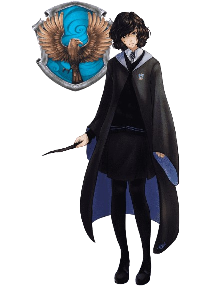

  

  <strong>Data Science · Applied AI · Psychology &amp; Human-Centred Technology</strong>

  
  
  

Hi there! I'm **Dewdu Sendanayake**, a **Data Science Intern at Pearson** and a final-year **B.Sc. (Hons) Information Technology undergraduate specializing in Data Science at SLIIT**.

I enjoy connecting data, technology, and an understanding of people. My projects span applied machine learning, AI assistants, data engineering, and interactive applications—with a particular interest in making complex ideas useful and understandable.

##  About Me

- 💼 **Currently:** gaining industry experience in data science at Pearson while completing my degree.
- 🎓 **Research:** contributed to a four-member final-year project on multimodal anxiety vulnerability mapping and escalation forecasting, with a focus on wearable physiological sensing and forecasting.
- 🧠 **Perspective:** a psychology diploma holder interested in human behaviour, mental health, and thoughtful technology.
- 🌱 **Growing toward:** roles that connect technical teams, clear communication, project delivery, and people.
- 🧙🏻‍♀️ **Beyond work:** space and NASA, aesthetic design, women in STEM, and a little Ravenclaw curiosity.

##  Selected Projects

A few starting points from my work in research, AI, and analytics:

| Project | What it explores | Core tools |
| :--- | :--- | :--- |
| **[🫀 Multimodal Anxiety Research](https://github.com/DewduSendanayake/Multimodal-Digital-Biomarkers-for-Personalized-Anxiety-Vulnerability-and-Escalation-Forecasting)** | Team research combining physiological, behavioural, clinical-language, and contextual signals. My component focuses on wearable biosignals, personalized anomaly detection, and short-horizon forecasting. | Python, LSTM autoencoder, Ridge regression, Flutter, ESP32 |
| **[🌴 Seasonal Travel Recommender](https://github.com/DewduSendanayake/Seasonal-Travel-Recommender)** | A multi-agent assistant for planning Sri Lankan travel around seasons, weather, and user preferences. | LangGraph, FastAPI, React, vector search |
| **[📚 TextNest AI](https://github.com/DewduSendanayake/TextNest-AI)** | Local PDF question answering with document retrieval and a locally running language model. | LangChain, FAISS, Mistral 7B, Streamlit |
| **[🧠 EmbedSense](https://github.com/DewduSendanayake/EmbedSense)** | Semantic text embeddings inside a Chrome extension, using a sandbox for browser-based ML inference. | TensorFlow.js, Universal Sentence Encoder, Manifest V3 |
| **[📊 Retail Insight 360](https://github.com/DewduSendanayake/Retail-Insight-360)** | A retail-price data warehouse with historical dimension tracking, OLAP analysis, and reporting. | SQL Server, SSIS, SSAS, Power BI |
| **[🎥 Video Similarity Search](https://github.com/DewduSendanayake/Video-Similarity-Search)** | Content-based video retrieval using sampled frames, visual embeddings, and vector indexing. | CLIP, PyTorch, FAISS, Decord |

### 🫀 Research Spotlight · From Biosignals to Personalized Forecasts

My final-year research brings together my interests in data science and psychology. Within the team's multimodal framework, my focus is **wearable biosensor forecasting**: using physiological features, individual baselines, an LSTM autoencoder, and a Ridge forecasting stage to explore changes over time.

The wider project connects a custom chest strap, a mobile research app, and server-side analysis. It is an **academic research prototype**, with outputs interpreted within the limits of its validation.

**Explore the work:** [Research overview](https://github.com/DewduSendanayake/Multimodal-Digital-Biomarkers-for-Personalized-Anxiety-Vulnerability-and-Escalation-Forecasting) · [Aura mobile app](https://github.com/DewduSendanayake/anxiety_mobile_app) · [Chest-strap firmware](https://github.com/DewduSendanayake/Aura-Biomonitor) · [Research website source](https://github.com/DewduSendanayake/Anxiety_Research_Website)

### ✨ More to Explore

<strong>🤖 Applied AI, machine learning &amp; automation</strong>

- **[AutoQuill](https://github.com/DewduSendanayake/AutoQuill)** — Gmail extension connecting inquiry processing with AI-generated replies and PDF quotations.
- **[YummyCrew](https://github.com/DewduSendanayake/Yummy-Crew)** — experimental food recommendations using cooperating AI agents and vector retrieval.
- **[Denoising Diffusion Model](https://github.com/DewduSendanayake/Denoising-Diffusion-Probabilistic-Model)** — a PyTorch image-generation pipeline with a UNet, attention, and iterative denoising.
- **[Semantic Pet Vision](https://github.com/DewduSendanayake/Semantic-Pet-Vision)** — natural-language image retrieval with CLIP and DocArray.
- **[Disease Risk Prediction](https://github.com/DewduSendanayake/Disease-Risk-Prediction)** — an educational health-data ML application using LightGBM and feature preprocessing.
- **[Customer Churn Predictor](https://github.com/DewduSendanayake/Customer-Churn-Predictor)** — telecom churn inference through a Streamlit interface.
- **[Handwritten Digit Recognizer](https://github.com/DewduSendanayake/Handwritten-Digit-Detection)** — a drawable canvas connected to a TensorFlow CNN.
- **[Privacy Censor](https://github.com/DewduSendanayake/Privacy-Censor)** — live webcam face detection and adjustable blur with OpenCV.

<strong>📈 Data engineering, dashboards &amp; statistical analysis</strong>

- **[ODI Cricket Analytics](https://github.com/DewduSendanayake/ODI-Cricket-Analytics)** — Snowflake ELT from nested match JSON to dimensional analytics.
- **[Spotify Dashboard](https://github.com/DewduSendanayake/Spotify-PowerBI-Dashboard)** — music data enrichment and interactive Power BI storytelling.
- **[Netflix Dashboard](https://github.com/DewduSendanayake/Netflix-Data-Pipeline-and-Dashboard)** — Power Query preparation, DAX measures, and catalogue exploration.
- **[Video Game Sales Dashboard](https://github.com/DewduSendanayake/Video-Games-Sales-Dashboard)** — regional sales comparisons and interactive Tableau analysis.
- **[Income & Social Media Engagement](https://github.com/DewduSendanayake/Income-And-Social-Media-Engagement-Analysis)** — statistical exploration using correlation, ANOVA, t-tests, and regression.
- **[Titanic EDA](https://github.com/DewduSendanayake/EDA-Titanic)** — data preparation, visual exploration, and feature analysis.

<strong>🌸 Web, mobile &amp; creative applications</strong>

- **[AthletiSense](https://github.com/DewduSendanayake/AthletiSense)** — wearable telemetry, cloud synchronization, and athletic-performance analytics.
- **[Nexora](https://github.com/DewduSendanayake/Nexora)** — a culinary learning platform with learning plans and progress tracking.
- **[Sobha Plantations](https://github.com/DewduSendanayake/Sobha-Plantations)** — a MERN application for cultivation and operations management.
- **[Lumos](https://github.com/DewduSendanayake/Lumos-MobileApp)** — a mobile app exploring dream journaling and sleep-related experiences.
- **[Aurora](https://github.com/DewduSendanayake/Aurora-MobileApp)** — a productivity app with tasks, a timer, reminders, and a home-screen widget.
- **[Event Management System](https://github.com/DewduSendanayake/Event-Management-System)** — a Java web application using MVC, JSP/Servlets, and MySQL.
- **[Hogwarts House Sorting](https://github.com/DewduSendanayake/Hogwarts-House-Sorting)** — a playful Flask project deployed through GitHub Actions.
- **[Tic-Tac-Toe](https://github.com/DewduSendanayake/Tic-Tac-Toe)** — a small interactive game.

## 🛠️ Tools I've Worked With

| Area | Technologies |
| :--- | :--- |
| **Data & analysis** | Python, R, SQL, pandas, NumPy, Jupyter, Matplotlib, Seaborn |
| **Machine learning** | scikit-learn, TensorFlow, Keras, PyTorch, LightGBM, XGBoost, OpenCV |
| **Language & retrieval** | LangChain, LangGraph, CrewAI, Sentence Transformers, FAISS, CLIP |
| **BI & data engineering** | Power BI, Tableau, Excel, Snowflake, SQL Server, SSIS, SSAS, Oracle |
| **Applications** | FastAPI, Flask, Streamlit, React, Spring Boot, Flutter, Kotlin, JavaScript |
| **Cloud & collaboration** | AWS, Git, GitHub, REST APIs |

## 🌙 GitHub Activity

  

##  Let's Connect!

I'm happy to connect over applied AI, data storytelling, research, and projects that bring technology closer to people's needs.

- **LinkedIn:** [Dewdu Sendanayake](https://www.linkedin.com/in/dewdusendanayake/)
- **Email:** [hdsendanayake01@gmail.com](mailto:hdsendanayake01@gmail.com)

Thanks for stopping by. Explore a project, share an idea, or say hello! ✨

  
   
  <em>Curiosity, creativity, and a little Ravenclaw magic.</em>

  

